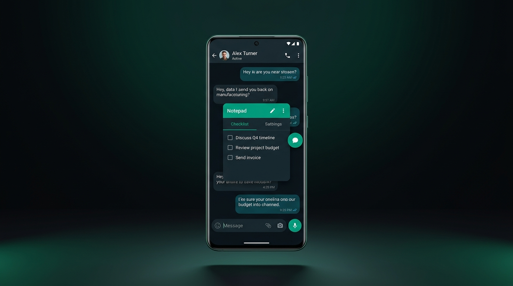
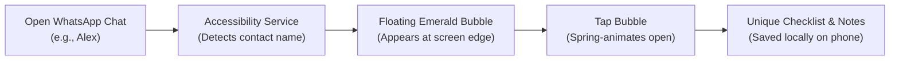

# 📝 ChatNotes: Floating Notes & Checklists for WhatsApp

  

  <strong>Never forget what to discuss on WhatsApp again.</strong> 
  A private, floating scratchpad that automatically appears when you open any chat.

  
  
  
  

---

## 💡 The Problem
Ever open a chat on WhatsApp with a friend, client, or colleague and completely forget the 3 things you wanted to bring up with them? You write notes in a separate app, but you always forget to open it before sending a message.

## ✨ The Solution: ChatNotes
**ChatNotes** is a lightweight Android companion utility that detects who you're chatting with in real-time and floats a mini private scratchpad directly over WhatsApp:

- **👤 Unique Per Contact**: Each contact gets their own independent checklist and memo pad. Data never mixes between chats.
- **☑️ Interactive Checklist**: Write down talking points and tick them off as you discuss them in the chat.
- **📝 Freeform Notes**: Store addresses, links, bank details, or general background info about that person.
- **🫧 Draggable Floating Bubble**: Floats like a Messenger chat head and smoothly glides/snaps to the screen edge.
- **👁️ Auto-Hides Outside Chats**: The bubble disappears when you leave the chat or switch to other apps, keeping your screen clutter-free.
- **🔒 100% Private & Offline**: All notes are stored locally on your device using on-device storage. Zero cloud transmission, zero analytics, zero ads.

---

## 📱 How It Works

1. **Accessibility Service**: Reads the current conversation header to load notes for that specific person.
2. **Overlay Window (`SYSTEM_ALERT_WINDOW`)**: Draws the lightweight floating notepad right above the chat so you never have to leave the conversation.
3. **Local Storage**: Automatically persists checklist completion states and text notes offline.

---

## 🚀 Quick Download & Installation

You do **not** need Android Studio or a developer environment to install and use ChatNotes:

### 1. Download the APK
Download the latest pre-compiled **`ChatNotes-APK`** directly from the **[Actions Tab](https://github.com/srikar-muthyala/ChatNotes-/actions)** (or Releases).

### 2. Grant Permissions
When you open ChatNotes for the first time, enable the two required permissions:
1. **Appear on Top**: Turn the switch ON for ChatNotes.
2. **Accessibility Service**: In your phone's Accessibility settings under *Downloaded Apps*, toggle ChatNotes to **ON**.

> **Note for Android 13 & 14 users**: If Android shows *"Restricted setting"*, go to **Settings > Apps > App management > ChatNotes > tap the three dots (⋮) in the top right corner > Allow restricted settings**.

---

## 🛠️ Built With

- **Language**: Kotlin
- **Architecture**: Android Services (`AccessibilityService` + `WindowManager` Overlay)
- **UI & Styling**: Material 3 Design + WhatsApp Emerald Theme with Spring Physics Animations
- **Persistence**: Fast offline JSON repository
- **CI/CD**: GitHub Actions cloud build pipeline

---

## 📄 License
This project is open-source and free for personal and commercial use.
